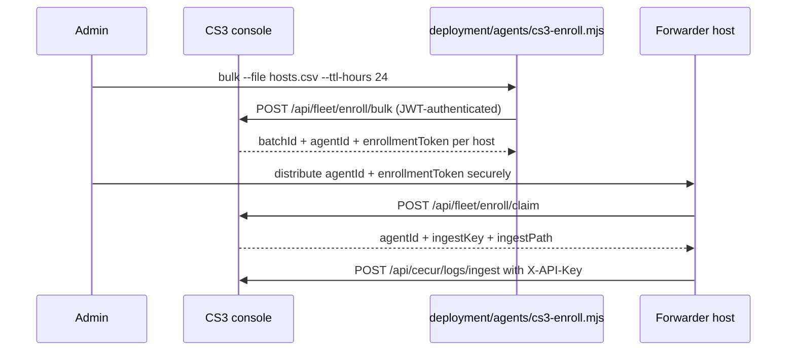

# Agent fleet management SOP

This SOP covers bulk enrollment, rollout, health monitoring, auto-remediation, and decommissioning for CS3 forwarders.

It is aligned to:

- `demo/demo-100226/server/routes/fleet.ts`
- `demo/demo-100226/server/fleet/enrollment.ts`
- `deployment/agents/{Install-CecurForwarder.ps1,install-forwarder.sh,cs3-enroll.mjs,cs3-forwarder-watchdog.sh}`
- `deployment/ansible/playbooks/{deploy-forwarders,health-remediation}.yml`

## 1. Enrollment behavior implemented by CS3

| Behavior | Current implementation |
|---|---|
| Bulk enrollment route | `POST /api/fleet/enroll/bulk` |
| Claim route | `POST /api/fleet/enroll/claim` |
| Fleet summary route | `GET /api/fleet/summary` |
| Bulk batch limit | `1000` agents per request unless overridden by `CS3_ENROLL_MAX_BATCH` |
| Default token TTL | `24` hours |
| Maximum token TTL | `168` hours |
| Claim auth model | Unauthenticated route protected by high-entropy, single-use, expiring token |
| Claim throttling | 20 failed claims per minute per source IP, then HTTP `429` |
| Claim response | `agentId`, `ingestKey`, `ingestPath=/api/cecur/logs/ingest` |
| Ingest auth | shared `SOC_INGESTION_SECRET` or per-agent key minted at claim time |

## 2. End-to-end bulk enrollment flow



## 3. Prepare the CSV

Use one row per endpoint. Keep hostnames unique; duplicates are rejected.

```csv
hostname,ip,platform,osName,osVersion,arch,workloadType,group
lin-app-001,10.55.10.11,linux,RHEL,9.4,x86_64,local,prod-linux
win-dc-001,10.55.20.21,windows,Windows Server,2022,x86_64,virtual,prod-windows
edge-k8s-001,10.55.30.31,container,Ubuntu,24.04,x86_64,container,prod-k8s
```

Accepted `platform` values: `linux`, `windows`, `macos`, `container`.

Accepted `workloadType` values: `local`, `virtual`, `container`, `cloud`.

## 4. Bulk enrollment command

Authenticate first: export `CS3_TOKEN` (an admin token with the `manage_fleet` action), or `CS3_USERNAME` + `CS3_PASSWORD` and the CLI logs in for you. The CLI writes one-time tokens to `cs3-enrollment-<batch>.json` (mode 0600); feed that file to `playbooks/deploy-forwarders.yml` (`-e cs3_enrollment_file=...`) and then shred it.

```bash
node deployment/agents/cs3-enroll.mjs bulk \
  --url https://cs3.example.mil \
  --file hosts.csv \
  --ttl-hours 24 \
  --group prod-linux
```

### Dry run

```bash
node deployment/agents/cs3-enroll.mjs bulk \
  --url https://cs3.example.mil \
  --file hosts.csv \
  --ttl-hours 24 \
  --dry-run
```

### Batch sizing rule

- keep each request at or below 1,000 agents unless `CS3_ENROLL_MAX_BATCH` is intentionally raised
- for 1,000+ endpoints, split by wave or site and submit multiple batches

## 5. Secure token distribution

Treat each `enrollmentToken` like a one-time password.

Approved methods:

- Ansible vault variables delivered only to the intended host
- Intune / SCCM / Jamf / MDM secret payloads scoped to the device
- sealed bootstrap file delivered through an approved software-distribution system
- out-of-band password manager entry for small emergency batches

Do **not** email enrollment tokens in cleartext or store them in long-lived ticket comments.

## 6. Claim and install

### Linux

The token is read from the environment (or `--token-file`), never from argv, so it does not appear in `ps` output.

```bash
sudo CS3_ENROLL_TOKEN='<one-time token>' deployment/agents/install-forwarder.sh \
  --console-url https://ingest.cs3.example.mil \
  --agent-id cecur-ag-001122334455 \
  --ca-file ./internal-ca.pem \
  [--pin-sha256 <base64 SPKI hash>] \
  [--fluent-bit-pkg ./fluent-bit.deb --fluent-bit-sha256 <hex>]   # air-gapped
```

### Windows

```powershell
$t = Read-Host -AsSecureString 'Enrollment token'
.\deployment\agents\Install-CecurForwarder.ps1 `
  -ConsoleUrl https://ingest.cs3.example.mil `
  -AgentId cecur-ag-001122334455 `
  -EnrollmentToken $t -CaFile .\internal-ca.pem `
  -FluentBitZip .\fluent-bit-win64.zip -FluentBitSha256 <hex>
```

### Ansible-managed Linux fleet

```bash
ansible-playbook deployment/ansible/playbooks/deploy-forwarders.yml -i inventories/prod/hosts.ini \
  -e @deployment/ansible/vars/onprem.yml -e cs3_enrollment_file=$PWD/cs3-enrollment.json
```

The installer or playbook should:

1. call `POST /api/fleet/enroll/claim`
2. receive the `ingestKey`
3. write the forwarder config with `X-API-Key: <ingestKey>`
4. optionally obtain and install the client certificate described in `mtls-certificate-pinning.md`
5. start the forwarder service and watchdog

## 7. Rollout waves for 1,000+ endpoints

Recommended wave plan:

| Wave | Population | Gate |
|---|---:|---|
| Canary | 1% or at least 25 hosts | No unexpected 401/429/5xx; stable heartbeat |
| Wave 1 | 10% | Same plus normal CPU/memory footprint |
| Wave 2 | 25% | No drift in ingest latency or certificate failures |
| Wave 3 | Remaining 64% | Execute only after the first three waves stay stable for one business cycle |

Split very large fleets by:

- site or enclave
- operating system family
- workstation vs. server
- criticality tier

## 8. Health checks and auto-remediation

### Watchdog pattern

Use `deployment/agents/cs3-forwarder-watchdog.sh` under a `systemd` timer or cron on Linux, and a Scheduled Task on Windows.

**Example systemd timer**

```ini
# /etc/systemd/system/cs3-forwarder-watchdog.timer
[Unit]
Description=Run the CS3 forwarder watchdog every 5 minutes

[Timer]
OnBootSec=2m
OnUnitActiveSec=5m
Unit=cs3-forwarder-watchdog.service

[Install]
WantedBy=timers.target
```

**Example systemd service**

```ini
# /etc/systemd/system/cs3-forwarder-watchdog.service
[Unit]
Description=CS3 forwarder watchdog

[Service]
Type=oneshot
ExecStart=/usr/local/bin/cs3-forwarder-watchdog.sh
```

**Example Windows Scheduled Task**

```powershell
$action = New-ScheduledTaskAction -Execute 'PowerShell.exe' -Argument '-File C:\Program Files\CecurIT\cs3-forwarder-watchdog.ps1'
$trigger = New-ScheduledTaskTrigger -Once -At (Get-Date).AddMinutes(1) -RepetitionInterval (New-TimeSpan -Minutes 5)
Register-ScheduledTask -TaskName 'CS3 Forwarder Watchdog' -Action $action -Trigger $trigger -RunLevel Highest -Force
```

### Fleet summary monitoring

Poll `GET /api/fleet/summary` to watch:

- total enrolled agents
- `byStatus.active`
- `byStatus.disconnected`
- pending unclaimed enrollments

Use it as the top-level fleet KPI. For per-host stale heartbeat age, combine it with the agent inventory data the forwarder publishes or your CMDB/EDR source of truth.

### Remediation ladder

1. **Restart** the service.
2. **Reconfigure** the service (API key, TLS chain, endpoint URL).
3. **Reinstall** the forwarder package.
4. **Quarantine** the endpoint if it continues to fail or looks compromised.

### Ansible remediation

```bash
ansible-playbook deployment/ansible/playbooks/health-remediation.yml -i inventories/prod/hosts.ini --limit stale_agents
```

## 9. Quarantine and decommissioning

### Quarantine

Use when a host is compromised or cannot be trusted.

- revoke or block the client certificate at the edge
- remove or invalidate the per-agent ingest key in the enrollment store or edge policy
- move the host to an isolated network/VLAN if available
- preserve logs and installer state for forensics

### Decommission

1. Stop and disable the forwarder service.
2. Remove the scheduled watchdog.
3. Revoke the client certificate.
4. Remove the host from the deployment inventory.
5. Mark the endpoint as decommissioned or isolated in operational records.

There is no dedicated public REST decommission route in the current demo API, so key or certificate invalidation is the practical revocation path today.

## 10. Validation checks

- `curl -fsS https://cs3.example.mil/api/fleet/summary`
- `journalctl -u cecur-forwarder --since -15m`
- `systemctl status cecur-forwarder cecur-forwarder-watchdog.timer`
- Windows: `Get-Service CecurForwarder`, `Get-ScheduledTask -TaskName 'CS3 Forwarder Watchdog'`
- confirm one successful `201` response from `POST /api/cecur/logs/ingest` after install
