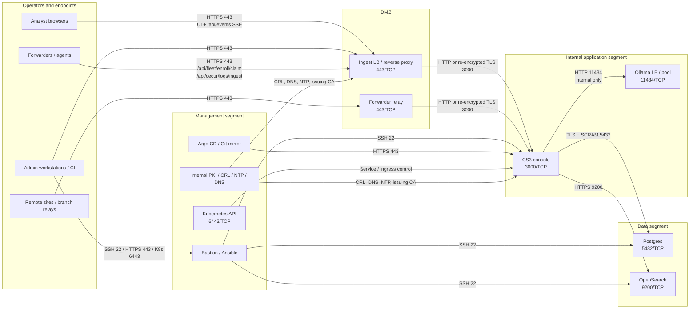
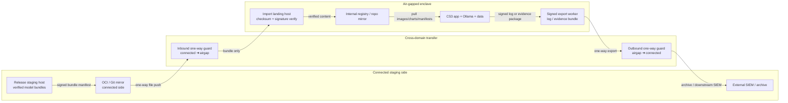

# CS3 Networking Architecture

This document defines the production network layout for the CS3 SOC platform across the `cloud`, `onprem`, and `airgap` profiles. It is aligned to the current console/runtime behavior in `deployment/docker/docker-compose.yml`, the fleet APIs in `demo/demo-100226/server/routes/fleet.ts`, and the enrollment/authentication flow in `demo/demo-100226/server/fleet/enrollment.ts`.

## 1. Segmented reference architecture

## 2. Air-gap cross-domain transfer path

Use a one-way guard or data diode for **inbound model bundle / image mirror updates** and a separate one-way path for **outbound signed log or evidence export**. Do not create an interactive return path into the air-gapped enclave.

## 3. Profile-specific deltas

| Profile | Inference path | External egress posture | Notes |
|---|---|---|---|
| `cloud` | Hosted model providers; `OLLAMA_BASE_URL` must remain unset | Allow-listed HTTPS egress to IdP, container registry, and hosted model APIs | `onboarding/env.cloud.template` requires `GEMINI_API_KEY` and `DEEPSEEK_API_KEY`. |
| `onprem` | Local Ollama through `OLLAMA_BASE_URL=http://127.0.0.1:11434/v1` or an internal pool | Internet egress may be allow-listed for updates and image/model acquisition only | `onboarding/env.onprem.template` leaves `GEMINI_API_KEY` and `DEEPSEEK_API_KEY` blank on purpose. |
| `airgap` | Local Ollama only | No routine internet egress; all updates cross the one-way guard as verified bundles | `onboarding/env.airgap.template` disables telemetry/update checks and requires verified bundle metadata. |

## 4. Port and flow matrix

| ID | Source | Destination | Port / proto | Purpose | Authentication / security |
|---|---|---|---|---|---|
| F1 | Analyst browser | DMZ reverse proxy | 443/TCP | Console UI, API calls, `GET /api/events` SSE | SSO/JWT session, MFA at IdP, TLS 1.2+ |
| F2 | Admin workstation / automation | DMZ reverse proxy | 443/TCP | Admin API access including fleet enrollment | SSO/JWT session with `manage_fleet`; TLS 1.2+ |
| F3 | Forwarder / endpoint agent | DMZ reverse proxy | 443/TCP | `POST /api/fleet/enroll/claim` bootstrap | One-time enrollment token, TLS; optional bootstrap client cert |
| F4 | Forwarder / endpoint agent | DMZ reverse proxy | 443/TCP | `POST /api/cecur/logs/ingest` | `X-API-Key` (shared or per-agent), recommended mTLS, optional certificate pinning |
| F5 | Remote site relay | DMZ forwarder relay | 443/TCP | Site-to-core buffered relay | mTLS between relays plus API key on ingest hop |
| F6 | DMZ reverse proxy / relay | CS3 console service | 3000/TCP | Reverse-proxied application traffic | Network allow-list; prefer re-encrypted TLS or mesh mTLS on Kubernetes |
| F7 | CS3 console | Postgres | 5432/TCP | State, enrollments, append-only audit log, LISTEN/NOTIFY | TLS + SCRAM-SHA-256 credentials (`cs3_app`, `cs3_migrator`, `cs3_archiver`) |
| F8 | CS3 console | OpenSearch | 9200/TCP | Search / indexer path (`CECUR_INDEXER_URL`) | HTTPS with basic auth or mTLS; restrict by security group / ACL |
| F9 | CS3 console | Ollama LB / pool | 11434/TCP | Local inference API (`OLLAMA_BASE_URL`) | Internal-only network path; optional mesh mTLS if service mesh is enabled |
| F10 | Reverse proxy / load balancer | CS3 console `/api/health` | 3000/TCP | Health checks | Source-IP allow-list; no user auth required |
| F11 | Bastion / Ansible control node | Servers and cluster nodes | 22/TCP | OS maintenance, playbooks, break-glass access | SSH keys or SSH CA; bastion only |
| F12 | Platform admin workstation | Kubernetes API | 6443/TCP | Cluster administration | Client cert or OIDC kubeconfig; admin CIDR allow-list |
| F13 | Platform admin workstation | Argo CD | 443/TCP | GitOps operations and rollbacks | SSO/OIDC, RBAC, TLS |
| F14 | CS3 nodes / gateways | Internal PKI / CRL / OCSP / NTP / DNS | 53/UDP,TCP; 80/443/TCP; 123/UDP | Name resolution, time sync, certificate validation | Internal PKI trust anchors; CRL/OCSP as supported by gateway |
| F15 | Connected staging mirror | Air-gap import landing host through one-way guard | vendor-specific (recommended 443/TCP file API or SFTP 22/TCP) | Verified model bundles, Helm charts, OCI images, Git mirror sync | Detached signatures + SHA-256 verification on receipt |
| F16 | Air-gap export worker | Connected archive / downstream SIEM through one-way guard | 6514/TCP or 443/TCP | Signed log export / evidence package export | mTLS or signed object upload; no reverse session |

## 5. Design requirements

1. **Terminate internet/site traffic only in the DMZ.** The console, Ollama pool, Postgres, and OpenSearch stay off directly reachable networks.
2. **Keep the data segment non-routable from endpoints.** Only the console and approved management hosts may talk to Postgres/OpenSearch.
3. **Treat `3000/TCP`, `5432/TCP`, `9200/TCP`, and `11434/TCP` as east-west only.** Never expose them to the internet.
4. **Separate enrollment from steady-state ingest.** `POST /api/fleet/enroll/claim` is intentionally unauthenticated except for the single-use token, while `POST /api/cecur/logs/ingest` should use both API-key auth and mTLS in regulated deployments.
5. **Preserve time sync.** Clock skew breaks certificate validation, audit correlation, and token TTL handling.
6. **In `airgap`, move artifacts only through a controlled import/export station.** Do not temporarily “bridge” the enclave for convenience.

## 6. Minimum DNS names

Use distinct DNS names so policy can differ by endpoint even when a shared reverse proxy is used:

- `cs3.example.mil` - analyst/admin console
- `ingest.cs3.example.mil` - forwarder ingest and SSE-safe reverse proxy
- `enroll.cs3.example.mil` - enrollment claim bootstrap (can share VIP if path-based routing is enforced)
- `argocd.cs3.example.mil` - GitOps control plane
- `registry.airgap.example.mil` - internal OCI mirror for the air-gapped profile

## 7. Validation checklist

- `curl -fsS https://cs3.example.mil/api/health`
- `curl -N https://cs3.example.mil/api/events` returns a `CONNECTED` SSE frame
- `curl -fsS -X POST https://ingest.cs3.example.mil/api/cecur/logs/ingest -H 'X-API-Key: …' -H 'Content-Type: application/json' -d '{"message":"smoke test","source":"syslog"}'`
- `openssl s_client -connect ingest.cs3.example.mil:443 -servername ingest.cs3.example.mil -showcerts </dev/null`
- Confirm firewall policy drops direct access to `3000`, `5432`, `9200`, and `11434` from user and endpoint networks
